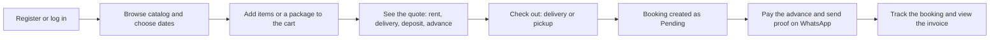
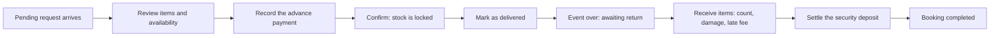
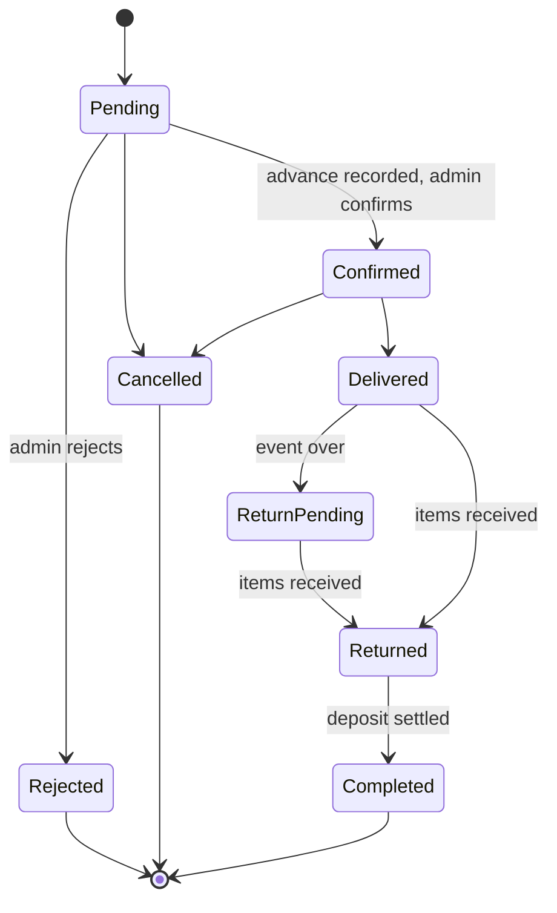

# Dastarkhwan (دسترخوان)

A crockery rental website for weddings, daawats and family gatherings. Customers browse the catalog, pick dates, get an instant quote and book online. The shop owner (admin) reviews each request, takes payments, tracks delivery and returns, and settles the security deposit.

Built on the LAMP stack (Ubuntu) with plain PHP and MySQL.

**Author:** Rabia Mubeen

---

## Tech stack

LAMP on Ubuntu: Linux (Ubuntu), Apache, MySQL and PHP.

---

## Features

### Customer
- Register, log in and manage bookings from a personal dashboard
- Browse the catalog by category, material and price, and check availability for chosen dates
- Ready-made event packages with a package discount
- Cart with a live cost calculator: rent, delivery fee, deposit and advance
- Checkout with delivery or shop pickup
- Booking confirmation page, printable invoice and a progress tracker for each booking

### Admin
- Dashboard: pending requests, handovers today, returns due, low stock and monthly revenue
- Sidebar navigation grouped into Orders, Catalog, Operations, People and System
- Bookings: confirm, reject, cancel, mark delivered, receive returns
- Payments ledger: advance, balance, security deposit, refunds, late fees and damage charges
- Return checklist with damage and missing-item charges, and security deposit settlement
- Catalog management: products, categories, packages, inventory calendar and stock adjustments
- Delivery zones with fees, shop settings, customer and admin accounts, and reports

---

## Project structure

```
public/        Web root. Each file is a page (a URL).
  admin/       Admin pages
  customer/    Customer pages
  api/         Small JSON endpoints (availability, quote)
  assets/      CSS, JavaScript, favicon
app/
  bootstrap.php   Loads everything, starts the session, sets security headers
  Auth.php        Login, registration, roles, throttling
  Csrf.php        Form tokens
  Database.php    PDO connection
  helpers.php     e(), url(), money(), flash messages, logo
  services/       All business rules and database queries
  views/          Shared layout: header.php, footer.php
config/        config.example.php (copy to config.php)
database/      SQL files 001 to 010, run in order
```

**How a request flows:** a page in `public/` requires `bootstrap.php`, checks the user with `Auth::requireRole()`, calls the services for the real work, then prints HTML between `header.php` and `footer.php`. Pages stay thin, and the rules live in `app/services/`.

---

## Requirements

- PHP 8.1 or newer with the `pdo_mysql` extension
- MySQL 5.7+ or MariaDB 10.3+

## Installation

```bash
# 1. Create the database and a user
mysql -u root -p -e "CREATE DATABASE dastarkhwan CHARACTER SET utf8mb4 COLLATE utf8mb4_unicode_ci;
CREATE USER 'dastarkhwan_user'@'localhost' IDENTIFIED BY 'your_password';
GRANT ALL ON dastarkhwan.* TO 'dastarkhwan_user'@'localhost';"

# 2. Create the tables (files are numbered in the order to run them)
cat database/0*.sql | mysql -u dastarkhwan_user -p dastarkhwan

# 3. Configure
cp config/config.example.php config/config.php
# Edit config/config.php: database password and base_url

# 4. Start the site
php -S localhost:8000 -t public
```

Set `base_url` in `config/config.php` to the address you open (for example `http://localhost:8000`), because every link is built from it. Set `debug` to `false` in production.

First steps after logging in as admin: open **Settings**, add a **Delivery zone**, create **Categories** and **Products**, then register a customer account in another browser and make a test booking.

---

## Workflow

### Customer flow



### Admin flow



### Booking status lifecycle



---

## Business rules

| Rule | How it works |
|------|--------------|
| Rental days | end date minus start date, plus 1. Maximum 30 days. |
| Subtotal | quantity × rent per day × days, summed over all items |
| Package discount | applies only to the package's own items |
| Total | subtotal − discount + delivery fee |
| Advance | a percentage of the total (default 30%), set in Settings |
| Security deposit | the larger of the minimum deposit and a percentage of replacement value. Held separately, not income. |
| Availability | total stock − units in confirmed, delivered or return-pending bookings that overlap the dates (buffer days included) − damaged or lost units |
| Stock locking | only a confirmed booking reserves stock. A pending booking does not. |
| Late fee | late days × the late fee per day |
| Damage charge | typed by the admin, or units × replacement cost by default |
| Deposit settlement | charges are deducted up to the amount held, and the rest is refunded as a payment. Extra charges beyond the deposit stay owed. |
| Cancellation | within 7 days of the event, the advance is non-refundable |

---

## Security

- Passwords are hashed, with at least 8 characters including a letter and a number
- Five failed logins within 15 minutes lock the login temporarily
- CSRF token on every form
- Sessions use HttpOnly, SameSite cookies, and time out after 2 hours of inactivity
- Role checks on every page: customers cannot open admin pages
- Content Security Policy and other security headers on every response
- The website can only create customer accounts. Admins are created from the command line.

---


## Pages

| Area | Pages |
|------|-------|
| Public | `index`, `catalog`, `packages`, `login`, `register` |
| Customer | `cart`, `checkout`, `booking-confirmation`, `customer/dashboard`, `customer/bookings`, `customer/booking`, `customer/invoice` |
| Admin | `dashboard`, `bookings`, `booking`, `booking-return`, `products`, `categories`, `packages`, `inventory`, `delivery-zones`, `reports`, `customers`, `admins`, `settings` |
| API | `api/availability`, `api/quote` |

---
